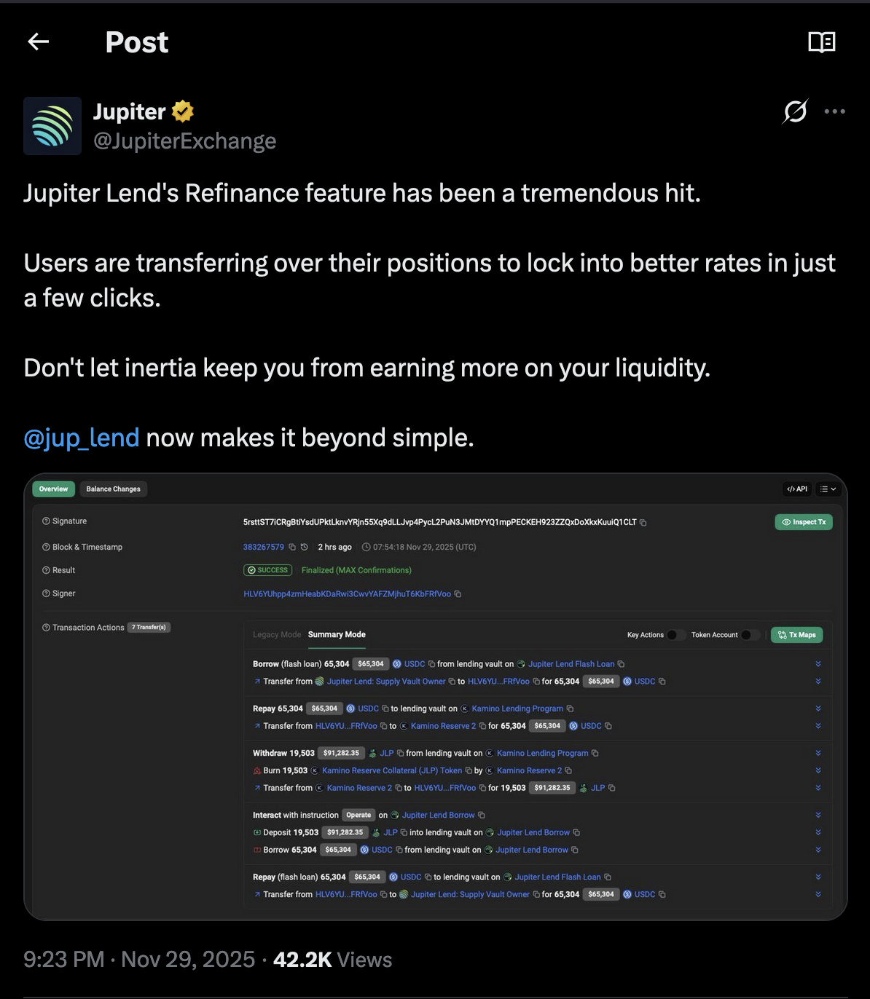
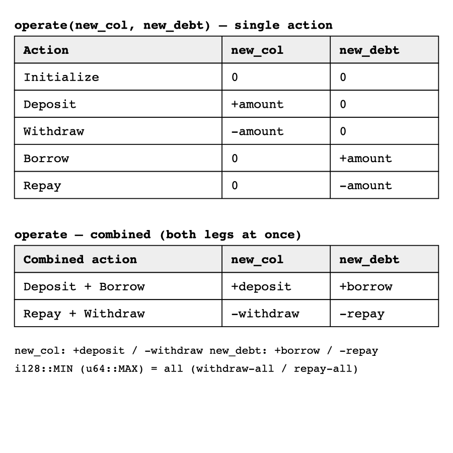
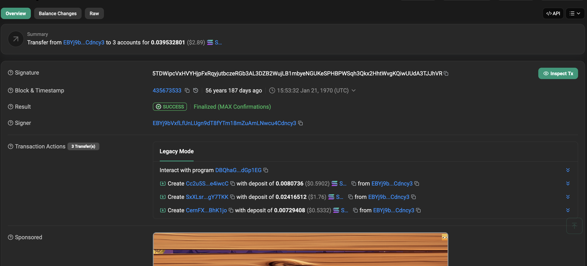
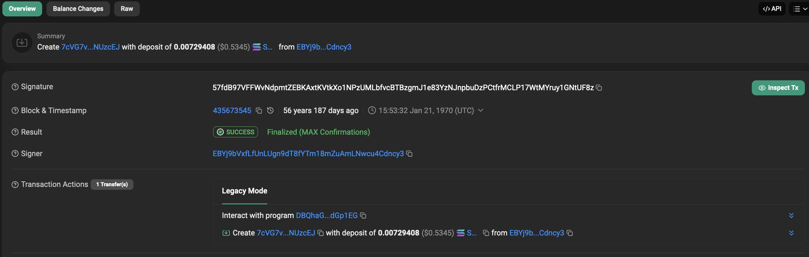
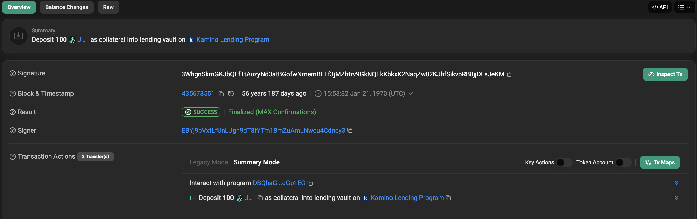
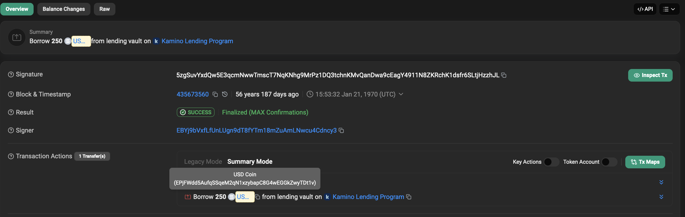
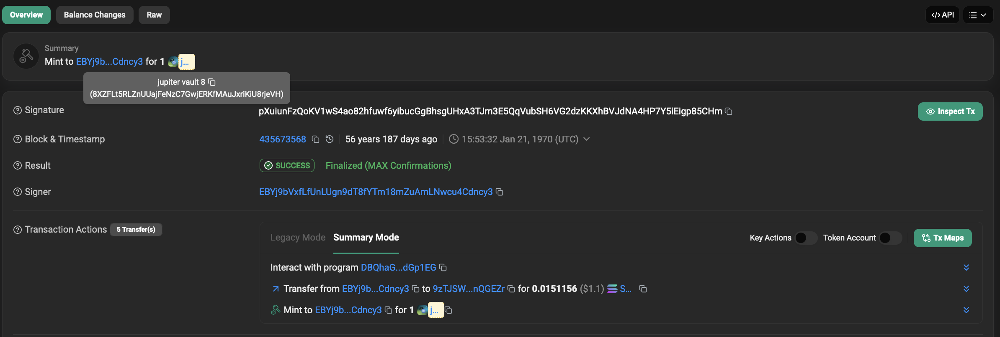
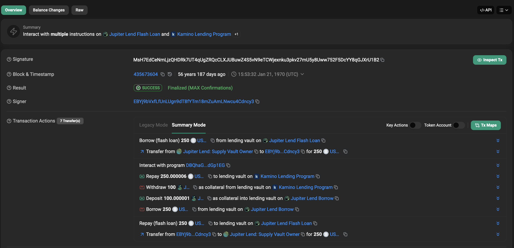
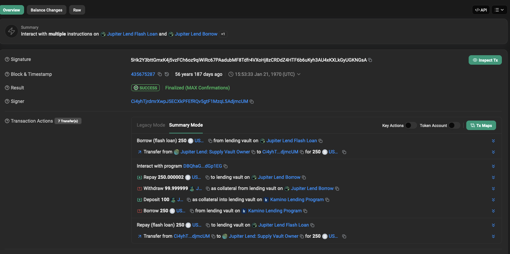

# Solana Lending Wars : Bypassing Kamino Finance Restricted Programs 

This article assumes the reader has a basic understanding of solana architecture and the anchor framework

Back in september 2025 jupiter launched their own lending protocol called [https://jup.ag/lend/earn](jupiter lend) in partnership with fluid, basically a solana rewrite of fluid lend.

Some weeks later, they introduced a feature called "Jupiter Refinance" which allowed you to one click migrate/refinance your loans from other lending protocols eg marginfi, kamino, including multiply positions, to jupiter lend, with the value proposition of having higher LTVs and APYs on your loans due to their better architecture and tick based liquidation design.




<!-- https://x.com/JupiterExchange/status/1994081765036544477?s=20

https://x.com/JupiterExchange/status/1994864718063047164 - refinance  -->

The refinance flow involved atomically repaying your loan using the zero fee flashloans from jupiter lend , withdrawing your collateral from the old lending venue (kamino finance in this example) then creating a new lending position in jupiter lend by depositing the same collateral, then borrowing the same asset.

But where it gets interesting is the steps/actions kamino took against it, basically hardcoding restrictions for transactions that involved jupiter lends borrow program through the repay instruction using the instruction sysvar with the logic being you can't repay your kamino loan, then the refinance flow cannot work and the lending position can't be migrated to jupiter lend.

Ironically, this restriction can easily bypassed and the purpose of the article is to explain how it can and also provide a functional solana program to do so, but first we have to understand some fundamental things - the instructions sysvar, cross program invocations and anatomy of solana flashloans work, lets get to it.

## Understanding the instruction sysvar

Sysvars in solana are basically read only system accounts that are used to access solana blockchain state.

The instruction sysvar is a specialized sysvar to access the serialized instructions of the current transaction including some metadata that are part of the transaction, by using it, we can introspect into the instructions of the current transaction and access their accounts and data.

(instructions in solana are made up of accounts, data, and the id of the program that we are executing)

We access sysvars in the anchor framework by listing them as a account under the `#[Derive(Accounts)]` struct using the address of the sysvar, in the code snippet below we are using the instruction sysvar and also adding an anchor constraint to ensure that the right address for the sysvar `Sysvar1nstructions1111111111111111111111111` is passed

```rust
    use anchor_lang::{
        prelude::*,
        solana_program::sysvar::{instructions::Instructions as SysInstructions},
        Accounts,
    };

    #[Derive(Accounts)]
    /// CHECK: Sysvar Instruction allowing introspection, fixed address
    #[account(address = SysInstructions::id())]
    pub instruction_sysvar_account: AccountInfo<'info>,
```

## (Cross program invocations) CPIs in solana

Cross program invocations or CPIs for short, is a functionality in solana that allows us to invoke the instructions of another existing program. In this example here we are invoking the burn instruction of the solana token program from our program using a cross program invocation (CPI)

```rust
pub fn burn<'info>(
    token_mint: AccountInfo<'info>,
    user_token_ata: AccountInfo<'info>,
    user: AccountInfo<'info>,
    token_program: AccountInfo<'info>,
    burn_amount: u64,
) -> Result<()> {
    anchor_spl::token::burn(
        CpiContext::new(
            token_program,
            anchor_spl::token::Burn {
                mint: token_mint,
                from: user_token_ata,
                authority: user,
            },
        ),
        burn_amount,
    )?;

    Ok(())
}
```

Solana uses a stack to track CPI calls, the initial stack height starts at 1, for every CPI call invoked, it adds 1 to the stack, the maximum number of nested cpi calls (Cpi depth) that can be invoked currently is [4](https://github.com/anza-xyz/agave/blob/master/program-runtime/src/execution_budget.rs?ref=blog.asymmetric.re#L8), but SIMD (solana improvement document) [0268](https://github.com/solana-foundation/solana-improvement-documents/blob/666aef1a6dc6b3a566ee4ad49d51beef8a792a93/proposals/0268-raise-cpi-nesting-limit.md) proposal increases it to 8.

## Understanding the program restriction and bypassing it

The kamino program restriction is invoked as an anchor account constraint for the instruction sysvar account that is passed in the list of accounts for the `RepayObligationLiquidity` instruction

```rust
#[derive(Accounts)]
pub struct RepayObligationLiquidity<'info> {
   
    pub owner: Signer<'info>,
    ///other accounts
    
    /// CHECK: Syvar Instruction allowing introspection, fixed address
    #[account(
        address = SysInstructions::id(),
        constraint = ix_utils::no_restricted_programs_within_tx(&instruction_sysvar_account)? @ LendingError::TransactionIncludesRestrictedPrograms
    )]
    pub instruction_sysvar_account: AccountInfo<'info>,
   
}

```

[source](https://github.com/Kamino-Finance/klend/blob/c06001927d68895be487482bdd82dcf6e88e6348/programs/klend/src/handlers/handler_repay_obligation_liquidity.rs#L149)

Lets breakdown the anchor constraint that invokes the program restriction, its a standard anchor check of the type `#[account(mut @ <custom_error>)]` where the function `no_restricted_programs_within_tx(&instruction_sysvar_account)` accepts the instruction sysvar account, is invoked during runtime and throws the custom error `LendingError::TransactionIncludesRestrictedPrograms` if it fails - that is the transaction involves an instruction containing an program id that is included in the restricted programs list.

```rust
 constraint = ix_utils::no_restricted_programs_within_tx(&instruction_sysvar_account)? @ LendingError::TransactionIncludesRestrictedPrograms
```

Now lets take a deeper dive into [ix_utils](https://github.com/Kamino-Finance/klend/blob/c06001927d68895be487482bdd82dcf6e88e6348/programs/klend/src/lending_market/ix_utils.rs#L161) and finally the `no_restricted_programs_within_tx` to see how everything works.

In `ix_utils` two solana_program helpers do the reading, and they're the only two concrete operations ix_utils actually needs:

`load_current_index_checked(sysvar)` → the index of the instruction currently executing.
`load_instruction_at_checked(index, sysvar)` → the Instruction (program id, accounts, data) sitting at that index. Everything else in ix_utils is an abstraction layered over these two methods.

Rather than calling the sysvar helpers directly everywhere, a trait for all the introspection logic is defined called the `InstructionLoader` which contains three more custom helpers `is_flash_forbidden_cpi_call` , `is_forbidden_cpi_call` and `tx_includes_restricted_programs` , the last helper is what we will be focusing on.

```rust
pub trait InstructionLoader {
    fn load_instruction_at(&self, index: usize) -> Result<Instruction, ProgramError>;
    fn load_current_index(&self) -> Result<u16, ProgramError>;
    fn is_flash_forbidden_cpi_call(&self) -> Result<bool>;
    fn is_forbidden_cpi_call(&self) -> Result<bool>;
    fn tx_includes_restricted_programs(&self) -> Result<bool>;
}
```

Another struct `BpfInstructionLoader` implements the `InstructionLoader` trait and just forwards to the actual sysvar account `instruction_sysvar_account_info`, passed in.

```rust
pub struct BpfInstructionLoader<'a, 'info> {
    pub instruction_sysvar_account_info: &'a AccountInfo<'info>,
}

impl InstructionLoader for BpfInstructionLoader<'_, '_> {
    fn load_instruction_at(&self, index: usize) -> Result<Instruction, ProgramError> {
        load_instruction_at_checked(index, self.instruction_sysvar_account_info)
    }
    fn load_current_index(&self) -> Result<u16, ProgramError> {
        load_current_index_checked(self.instruction_sysvar_account_info)
    }
}
```

So `BpfInstructionLoader::new(&instruction_sysvar_account)` is the object our constraint hands the sysvar to.

We create a custom iterator for the instructions called `IxIterator` to do this we implement the inbuilt rust trait [Iterator](https://doc.rust-lang.org/rust-by-example/trait/iter.html), where each item is an `Result<Instruction>` Object

```rust
impl<IxLoader: ?Sized> Iterator for IxIterator<'_, IxLoader>
where
    IxLoader: InstructionLoader,
{
    type Item = std::result::Result<Instruction, ProgramError>;
```

Now, to scan every instruction, the loader is now wrapped in an iterator that just increments from a starting index:

```rust
fn next(&mut self) -> Option<Self::Item> {
    match self.instruction_loader.load_instruction_at(self.current_ix_index) {
        Ok(ix) => {
            self.current_ix_index = self.current_ix_index.checked_add(1).unwrap();
            Some(Ok(ix))
        }
        Err(ProgramError::InvalidArgument) => None, // walked off the end → stop
        Err(e) => Some(Err(e)),
    }
}
```

The termination condition is the important detail: load_instruction_at_checked returns ProgramError::InvalidArgument when you ask for an index past the last instruction, and the iterator treats that as "done." So `IxIterator::new_at(0, loader)` yields instruction 0, 1, 2, … until the sysvar says there are no more — i.e. it enumerates exactly the transaction's instruction list, in order.

Now that we understand `ix_utils` and with the iterator in place, the restricted program check is rather straightforward.

```rust
fn tx_includes_restricted_programs(&self) -> Result<bool> {
    let ix_iterator = IxIterator::new_at(0, self);
    for ix_result in ix_iterator {
        let ix = ix_result?;
        if RESTRICTED_PROGRAMS.contains(&ix.program_id) {
            return Ok(true);
        }
    }
    Ok(false)
}
```

It iterates the whole transaction and returns true the moment it finds an instruction whose program_id is in the RESTRICTED_PROGRAMS list which currently only contains Jupiter Lend's borrow program:

```rust
pub const RESTRICTED_PROGRAMS: [Pubkey; 1] =
    [pubkey!("jupr81YtYssSyPt8jbnGuiWon5f6x9TcDEFxYe3Bdzi")];

pub fn no_restricted_programs_within_tx(
    instruction_sysvar_account_info: &AccountInfo,
) -> Result<bool> {
    let instruction_loader = BpfInstructionLoader::new(instruction_sysvar_account_info);
    Ok(!instruction_loader.tx_includes_restricted_programs()?)
}
```

Basically the key to bypassing this restriction depends on the fact that the instruction sysvar only holds the instructions at the stack depth of 1, that is, the top level instructions in a solana transaction. Put a jupr81 instruction at the top level next to a Kamino repay, and tx_includes_restricted_programs finds it → TransactionIncludesRestrictedPrograms. A naïve one-transaction Kamino→Jupiter refinance is dead on arrival.

So if we write a solana program that implements the same refinancing logic then the instruction that invokes the restricted jupiter borrow program (jupr81...) for either creating a new jupiter position in the same transaction that a kamino loan has been repayed will become an inner instruction with a stack depth of two, `tx_includes_restricted_programs` returns false, `no_restricted_programs_within_tx` returns true, the constraint passes, and the whole reifnance flow proceeds.

```markdown
Transaction
├── Instruction 0: Program A
│   ├── CPI -> Program B
│   │   └── CPI -> Program C
│   └── CPI -> Program D
├── Instruction 1: Program E
└── Instruction 2: Program F
```

Also this is the reason that most solana lending protocols that support flashloans do not allow you to execute a flashloan instruction via CPI because the flashloan check uses the instruction sysvar to introspect into the current transaction to check if there is a valid repay instruction that is, one with the equivalent borrowed asset type and amount, so it has to be top level (at CPI stack depth 1).

Lets go ahead and explain our bypass program

## Design and implementation of our program

To implement our program we use the [pinocchio](https://github.com/anza-xyz/pinocchio) framework - a lightweight solana framework that produces binaries far less than anchor with an optimized entrypoint.

### The entrypoint

Since this is a pinocchio program, we do instruction dispatch to route a discriminator (unique identifier for isntruction) manually. We choose the numbers 0 to 11 for our 11 instructions all methods to execute lending, borrow, withdraw and deposit actions on kamino or jupiter lend and refinancing both ways between kamino and jupiter lend

 `entrypoint!(process_instruction)` registers a single function the runtime calls for every instruction, and that function does all the demultiplexing itself.

The convention is as follows the **first byte of the instruction data is the discriminant**, the rest is that instruction's payload. `process_instruction` slices byte 0 from the data, matches it against a table of `u8` constants, and forwards the remaining bytes to the right instruction processor

```rust
entrypoint!(process_instruction);

const INIT_KAMINO: u8 = 0;
const INIT_JUPITER_LEND: u8 = 1;
//rest of the discriminators 

pub fn process_instruction(
    _program_id: &Pubkey,
    accounts: &[AccountInfo],
    instruction_data: &[u8],
) -> ProgramResult {
    if instruction_data.is_empty() {
        return Err(ProgramError::InvalidInstructionData);
    }
    let disc = instruction_data[0];   // selector
    let data = &instruction_data[1..]; // payload

    match disc {
        INIT_KAMINO        => kamino::processor::process_init(accounts, data),
        INIT_JUPITER_LEND  => juplend::processor::process_init(accounts, data),
        // ....rest of the code 
    }
}
```

For the major program design we follow the blueshifts beethoven [design architecture](https://github.com/blueshift-gg/beethoven/blob/master/crates/core/src/lib.rs#L58) where every protocol action is generalized by a trait each with a method, one method for implementing the protocol specific action where we use PDA signing and the other where we do not, each protocol implements the specifc trait with its specific account requirements and CPI logic.

```rust
#![allow(dead_code)]
use pinocchio::{instruction::Signer, ProgramResult};

pub trait Deposit<'info> {
    type Accounts;
    type Data;

    fn deposit(ctx: &Self::Accounts, amount: u64, data: &Self::Data) -> ProgramResult {
        Self::deposit_signed(ctx, amount, data, &[])
    }

    fn deposit_signed(
        ctx: &Self::Accounts,
        amount: u64,
        data: &Self::Data,
        signer_seeds: &[Signer],
    ) -> ProgramResult;
}

pub trait Withdraw<'info> {
    type Accounts;
    type Data;

    fn withdraw(ctx: &Self::Accounts, amount: u64, data: &Self::Data) -> ProgramResult {
        Self::withdraw_signed(ctx, amount, data, &[])
    }

    fn withdraw_signed(
        ctx: &Self::Accounts,
        amount: u64,
        data: &Self::Data,
        signer_seeds: &[Signer],
    ) -> ProgramResult;
}
```

Then we implement the method for each protoco, in this case we implement the logic for depositing into kamino finance and jupiter lend and for the rest of the3 actions -> initialize (position), borrow, withdraw, repay,

```rust 
// Jupiter Lend implementation
impl<'info> Deposit<'info> for JupiterLend {
    type Accounts = JupiterOperateAccounts<'info>;
    type Data = [u8; 3];

    fn deposit_signed(
        ctx: &Self::Accounts,
        amount: u64,
        data: &Self::Data,
        signer_seeds: &[Signer],
    ) -> ProgramResult {
        operate(ctx, amount as i128, 0, data, signer_seeds)
    }
}

//Kamino Finance Implementation
impl<'info> Deposit<'info> for Kamino {
    type Accounts = KaminoDepositAccounts<'info>;
    type Data = u8;

    fn deposit_signed(
        ctx: &Self::Accounts,
        amount: u64,
        flags: &Self::Data,
        signer_seeds: &[Signer],
    ) -> ProgramResult {
        let flags = *flags;

        refresh_reserve(
            ctx.reserve,
            ctx.lending_market,
            ctx.scope_oracle,
            ctx.kamino_lending_program,
        )?;

        if flags & FLAG_HAS_BORROWS != 0 {
            refresh_reserve(
                ctx.borrow_reserve,
                ctx.lending_market,
                ctx.scope_oracle_borrow,
                ctx.kamino_lending_program,
            )?;
        }

        refresh_obligation(
            ctx.lending_market,
            ctx.obligation,
            ctx.reserve,
            Some(ctx.borrow_reserve),
            flags,
            signer_seeds,
        )?;

        deposit_collateral(ctx, amount, signer_seeds)
    }
}
```

## Jupiter Lend `operate` deltas

Jupiter has an interesting and efficient design where every action is carried out through a single operate instruction with five parameters, two of which are the new collateral amount `new_col` and new debt amount `new_debt` , and the signs of each amount pick the action; while the magnitude is the amount.

With this we can represent the four fundamental lending actions - deposit, withdraw, borrow, repay and optionally inserting `u64::MAX` (encoded as `i128::MIN`) means "all" to pay all the debt, withdraw all the collateral, etc

[source](https://github.com/Instadapp/fluid-solana-programs/blob/626b177f235224bc5d074d39439cd2558f542886/programs/vaults/src/module/user.rs#L71)

```rust
pub fn operate<'info>(
    ctx: Context<'_, '_, 'info, 'info, Operate<'info>>,
    new_col: i128,
    new_debt: i128,
    transfer_type: Option<TransferType>,
    remaining_accounts_indices: Vec<u8>,
) -> Result<(u32, i128, i128)> 
```

With this a combination of signed amounts and magnitude can execute two actions together at once eg deposit and borrow, payback (repay) and withdraw.

Here is a table showing all the actions together.



## Kamino

The kamino implementation was more tedious because their collateral and borrows need to be refreshed before every borrow or repay transaction

Before any instruction invocation involving reserves in kamino finance, we need to refresh the relevant reserves for either the debt (obligation) and the collateral, we use a system of bitmasking adapted from this [repo](https://github.com/L0STE/anchor-looping-program/blob/main/programs/anchor-looping/src/lib.rs#L22)

So before each withdraw, deposit, borrow or repay kamino instruction invocatiion we add either refresh the collateral, and or the borrow, in order for the reserves to not be stale

## The reserve-refresh bitmask

Kamino won't let you touch an obligation until every reserve it holds has been refreshed *in the same slot*, and its `RefreshObligation` instruction is picky: you must hand it **exactly** the reserves the obligation currently holds — no more, no fewer — as remaining accounts. Pass a borrow reserve to an obligation that has no debt and it rejects the whole thing with a reserve-count mismatch.

That's a problem when you're chaining actions inside one transaction, because the obligation's composition *changes as you go* — repay all the debt and the borrow side vanishes; deposit collateral and the collateral side appears. So the program carries a tiny **bitmask** describing what the obligation holds, and rewrites it between sub-actions with plain bitwise ops.

Two bits, one for each side of a lending position:

```rust
pub const FLAG_HAS_COLLATERAL: u8 = 1 << 0; // 0b01
pub const FLAG_HAS_BORROWS:    u8 = 1 << 1; // 0b10
```

### The bitmask decides which reserves get refreshed

`refresh_obligation` reads the two bits and assembles the reserve list it forwards to Kamino's `RefreshObligation` — collateral if `FLAG_HAS_COLLATERAL` is set, borrow if `FLAG_HAS_BORROWS` is set:

```rust
pub fn refresh_obligation<'a>(
    lending_market: &'a AccountInfo,
    obligation: &'a AccountInfo,
    collateral_reserve: &'a AccountInfo,
    borrow_reserve: Option<&'a AccountInfo>,
    flags: u8,
    signers: &[Signer],
) -> ProgramResult {
    let mut reserve_infos: [MaybeUninit<&AccountInfo>; 2] = /* ... */;
    let mut count = 0usize;

    if flags & FLAG_HAS_COLLATERAL != 0 {
        reserve_infos[count].write(collateral_reserve);
        count += 1;
    }
    if flags & FLAG_HAS_BORROWS != 0 {
        if let Some(reserve) = borrow_reserve {
            reserve_infos[count].write(reserve);
            count += 1;
        }
    }
    // pass exactly `count` reserves to RefreshObligation
    refresh_obligation_with_reserves(lending_market, obligation, /* &reserves[..count] */, signers)
}
```

So the bitmask is a compact description of the obligation's current reserve set, and `flags & FLAG_X != 0` is just "does the obligation hold side X right now?".

### Each action refreshes its own side always, the other side conditionally

Every Kamino action follows the same rule: **always refresh the reserve it operates on; refresh the opposite side only if the obligation holds it.** `deposit` targets collateral, so it refreshes collateral unconditionally and the borrow reserve only when `FLAG_HAS_BORROWS` is set:

```rust
fn deposit_signed(ctx, amount, flags, signer_seeds) -> ProgramResult {
    let flags = *flags;

    refresh_reserve(ctx.reserve, ctx.lending_market, ctx.scope_oracle, ctx.kamino_lending_program)?;      // collateral: always

    if flags & FLAG_HAS_BORROWS != 0 {
        refresh_reserve(ctx.borrow_reserve, ctx.lending_market, ctx.scope_oracle_borrow, ctx.kamino_lending_program)?; // debt: only if held
    }

    refresh_obligation(ctx.lending_market, ctx.obligation, ctx.reserve, Some(ctx.borrow_reserve), flags, signer_seeds)?;
    deposit_collateral(ctx, amount, signer_seeds)
}
```

`withdraw` is the mirror image — its target *is* collateral, so same shape: refresh the withdraw reserve always, the borrow reserve only under `FLAG_HAS_BORROWS`.

`borrow` and `repay` target the **debt** side, so the condition flips — they refresh the borrow reserve unconditionally and the collateral reserve only under `FLAG_HAS_COLLATERAL`:

```rust
fn borrow_signed(ctx, amount, flags, signer_seeds) -> ProgramResult {
    let flags = *flags;

    if flags & FLAG_HAS_COLLATERAL != 0 {
        refresh_reserve(ctx.collateral_reserve, /* scope_oracle_collateral */ ..)?; // collateral: only if held
    }
    refresh_reserve(ctx.borrow_reserve, /* scope_oracle_borrow */ ..)?;             // debt: always

    refresh_obligation(ctx.lending_market, ctx.obligation, ctx.collateral_reserve, Some(ctx.borrow_reserve), flags, signer_seeds)?;
    borrow_from_reserve(ctx, amount, signer_seeds)
}
```

### Rewriting the mask between chained actions

This is where the bitmask earns its keep. In a refinance the actions run back-to-back on the *same* obligation, and each one mutates the obligation, so the flag we feed the *next* action has to reflect that mutation. The program does it with a single bitwise op each time.

**Kamino → Jupiter** repays, then withdraws. Repaying gets the caller's full flag (the obligation has both sides). But if we repaid **all** the debt (`u64::MAX`), the borrow side is now gone — so before the withdraw we **clear** the borrow bit with `& !FLAG_HAS_BORROWS`, leaving only collateral:

```rust
fn process_kamino_to_jupiter(&self) -> ProgramResult {
    // after a full repay the obligation no longer has a borrow → clear that bit
    let withdraw_flag = if self.data.source_repay_amount == u64::MAX {
        self.data.kamino_has_collateral_or_borrow_flag & !FLAG_HAS_BORROWS
    } else {
        self.data.kamino_has_collateral_or_borrow_flag
    };

    Kamino::repay(&repay_accounts, self.data.source_repay_amount,
                  &self.data.kamino_has_collateral_or_borrow_flag)?; // repay: original mask (still has debt)
    Kamino::withdraw(&withdraw_accounts, self.data.source_withdraw_amount,
                     &withdraw_flag)?;                               // withdraw: borrow bit cleared

    JupiterLend::deposit_and_borrow(/* ... */)
}
```

Had we left `FLAG_HAS_BORROWS` set, the withdraw's `refresh_obligation` would try to hand `RefreshObligation` a borrow reserve the obligation no longer has → count mismatch, revert.

**Jupiter → Kamino** is the inverse. The destination Kamino obligation starts empty, so `deposit` runs with the caller's mask (typically `0` — nothing held yet). After the deposit the obligation *has* collateral, so before the borrow we **set** the collateral bit with `| FLAG_HAS_COLLATERAL`:

```rust
fn process_jupiter_to_kamino(&self) -> ProgramResult {
    let deposit_flag = self.data.kamino_has_collateral_or_borrow_flag;   // fresh obligation → usually 0
    let borrow_flag  = deposit_flag | FLAG_HAS_COLLATERAL;               // after deposit, collateral exists → set the bit

    JupiterLend::repay_and_withdraw(/* ... */)?;
    Kamino::deposit(&deposit_accounts, self.data.destination_deposit_amount, &deposit_flag)?; // deposit: 0 reserves refreshed
    Kamino::borrow(&borrow_accounts,  self.data.destination_borrow_amount,  &borrow_flag)?;   // borrow: collateral bit set
}
```

So the whole scheme is: one `u8`, two meaningful bits, where `& FLAG` asks "does the obligation hold this side?", `| FLAG` records "it now does," and `& !FLAG` records "it no longer does." That's enough to keep `RefreshObligation`'s strict reserve list correct as the position is torn down on one venue and rebuilt on the other — without the client having to re-specify the obligation's shape at every step.

## Refinance 
`refinance.rs` has four components in it: the parsed instruction data, a unified Kamino account block, the account split, and the `Refinance` type that runs the migration. Everything here is composition, it doesn't define new actions, it arranges the existing ones.

### `RefinanceData`

The instruction payload, parsed from bytes. Four amounts (one per leg), the Kamino refresh flag, and Jupiter's three tick indices:

```rust
pub struct RefinanceData {
    pub source_repay_amount: u64,
    pub source_withdraw_amount: u64,
    pub destination_deposit_amount: u64,
    pub destination_borrow_amount: u64,
    pub kamino_has_collateral_or_borrow_flag: u8,
    pub jupiter_indices: [u8; 3],
}
```

Its `TryFrom<&[u8]>` just reads the fixed offsets out of the payload.

### `KaminoAccounts`

This is the important one. A single Kamino position touches different accounts depending on the action — a deposit needs the collateral reserve as its main reserve, a borrow needs the debt reserve, and so on. Instead of asking the caller to send four separate account lists, `KaminoAccounts` holds the full set once — the collateral leg, the debt leg, and the reserves used for refreshes — and exposes four methods that reshape it into the exact struct each action wants:

```rust
fn deposit_accounts(&self)  -> KaminoDepositAccounts  { /* collateral_reserve -> reserve, ... */ }
fn withdraw_accounts(&self) -> KaminoWithdrawAccounts { /* collateral_reserve -> withdraw_reserve, ... */ }
fn repay_accounts(&self)    -> KaminoRepayAccounts    { /* debt_reserve -> borrow_reserve, ... */ }
fn borrow_accounts(&self)   -> KaminoBorrowAccounts   { /* debt_reserve -> borrow_reserve, ... */ }
```

Same accounts underneath, different field names per action. That's how one Kamino block can feed all four Kamino calls.

### `RefinanceAccounts`

Holds the two halves of the account list: `juplend_accounts` (Jupiter's operate accounts) and `kamino_accounts` (the block above). Its `try_from_slice` is what splits the flat list. Jupiter's `operate` instruction always takes in 36 fixed accounts, so those are first; the Kamino block always starts with the Kamino Lend program id, so it scans past the 36 for that id, splits the array there, and parses each side:

```rust
let kamino_start = accounts[JUPITER_OPERATE_FIXED_ACCOUNTS..]
    .iter()
    .position(|a| a.key() == &KAMINO_LEND_PROGRAM_ID)
    .map(|off| JUPITER_OPERATE_FIXED_ACCOUNTS + off)?;
let (juplend_slice, kamino_slice) = accounts.split_at(kamino_start);
```

### `impl Refinance`

`Refinance` is just `RefinanceData` + `RefinanceAccounts`, built by a `TryFrom<(&[u8], &[AccountInfo])>` that parses both. Its two methods run the actual migration.

`process_kamino_to_jupiter` repays and withdraws on Kamino, then deposits and borrows on Jupiter. The only real logic here is adjusting the refresh flag between steps — if the repay closed the whole debt, it clears the borrow bit before the withdraw so the obligation refresh matches the position's new shape:

```rust
let withdraw_flag = if self.data.source_repay_amount == u64::MAX {
    self.data.kamino_has_collateral_or_borrow_flag & !FLAG_HAS_BORROWS
} else {
    self.data.kamino_has_collateral_or_borrow_flag
};

Kamino::repay(&repay_accounts, self.data.source_repay_amount, &self.data.kamino_has_collateral_or_borrow_flag)?;
Kamino::withdraw(&withdraw_accounts, self.data.source_withdraw_amount, &withdraw_flag)?;
JupiterLend::deposit_and_borrow(&self.accounts.juplend_accounts, self.data.destination_deposit_amount, self.data.destination_borrow_amount, &self.data.jupiter_indices)
```

`process_jupiter_to_kamino` is the mirror — repay and withdraw on Jupiter, then deposit and borrow on Kamino — and it sets the collateral bit before the borrow, since the deposit that just ran is what gives the obligation collateral.

Finally, two free functions wrap it for the entrypoint:

```rust
pub fn process_kamino_to_jupiter(accounts: &[AccountInfo], data: &[u8]) -> ProgramResult {
    Refinance::try_from((data, accounts))?.process_kamino_to_jupiter()
}
```

So what the whole `refinance.rs` just does - parse the data, split the accounts, reshape the Kamino block per action, and call the existing repay/withdraw/deposit/borrow steps in the right order for each refinance direction.


## Testing with LiteSVM and surfpool

Every instruction this program exposes is a CPI into the mainnet deployed Kamino Lend and Jupiter Lend programs, operating on their real reserves, obligations, vaults, farms, oracles, etc.  

 So the tests run against genuine mainnet state, opting for two methods of doing them 

- **Surfpool** — a tool for testing solana programs against the real mainnet state built on LiteSVM.
It lazily clones an account the first time a transaction reads it, caches it locally, and lets subsequent transactions mutate that local copy. Because the clone is byte-identical to mainnet, your CPIs execute against the genuine KLend and Jupiter programs. This is where the full refinance runs.

- **LiteSVM** — fast and lightweight library that creates an in process solana SVM not connected to mainnet. Nothing is automatically cloned; you dump every account and program as a `.so` binary and load them yourself in LiteSVM as fixtures.

### The `tests/` layout

The suite is deliberately split into small modules so the test files themselves stay a few lines long:

| File | Role |
|---|---|
| `constants.ts` | Contains all addresses, program id + the 10 discriminants, Kamino/Jupiter program ids. |
| `utils.ts` | surfpool cheatcode wrappers, the v0 transaction sender, lookup-table builder, and byte packers. |
| `jup_lend_loader.js` | ESM→CJS bridge for `@jup-ag/lend` — the SDK ships as an ES module, the tests compile to CommonJS, so it's loaded through a cached dynamic `import()`. |
| `program-instructions.ts` | `TransactionInstruction` builders for the single-action entrypoints (discriminants 0–7): Kamino init/deposit/borrow, Jupiter init and the combined operate. Account orders mirror the Rust structs exactly. |
| `refinance-helpers.ts` | The refinance instruction (discriminants 10/11): mapping the SDK's Jupiter operate accounts into the program's 36-slot order and concatenating the Kamino block. |
| `bootstrap.ts` | The orchestration layer: context factory, `prepare`, position openers, and all three refinance entry points (both directions plus the flashloan variant). |
| `tx-printer.ts` | The Solscan-in-the-terminal formatter: status, account roles, instruction list, the CPI/stack-height tree, and SOL/token deltas — sourced from an RPC response *or* a LiteSVM result. |
| `refinance-kamino-to-jup.ts` / `refinance-jup-to-kamino.ts` | The two surfpool integration tests (mocha), one per direction. |
| `litesvm-refinance.ts` | The deterministic LiteSVM test driven by dumped fixtures. |
| `flashloan-bypass-demo.ts` | The bypass-vs-control experiment that proves the restriction is real. |
| `fetch-refinanceable-markets.ts` | A standalone script that queries the Jupiter Lend and Kamino APIs to find pairs refinanceable on both venues. |
| `README.md` | How to run everything. |

Development scripts live alongside in `scripts/`: `dump-fixtures.ts` (snapshot mainnet for LiteSVM), `print-tx.ts` (dump any signature), `flashloan-refinance-tx.ts` (produce a flashloan refinance + its JSON), and a family of `probe-*.ts` files used to bring each step up one at a time.

### How surfpool boots and deploys itself

Starting surfpool forks mainnet and deploys the program in the same breath. The repo ships a txtx deployment runbook with `instant_surfnet_deployment = true`, which writes the program bytes straight into the program account via a cheatcode instead of sending a real multi-transaction BPF upload. The program id it lands at is the cargo-generated keypair, and `constants.ts` resolves `PROGRAM_ID` from that keypair automatically, so nothing needs wiring by hand:

```bash
surfpool start          # fork mainnet + instant-deploy the program
npm run test:kamino-to-jup
npm run test:jup-to-kamino
```


### The cheatcodes ([docs.surfpool.run](https://docs.surfpool.run/))

A fresh fork has no wallets and no balances, so the tests manually set state rather . Surfpool exposes 26 `surfnet_*` JSON-RPC methods for this (the full [cheatcodes reference](https://docs.surfpool.run/) groups them into account manipulation, program management, time control, profiling, and snapshots). The suite leans on a handful:

| Cheatcode | What it does | Used for |
|---|---|---|
| `surfnet_setAccount` | Set an account's lamports/data/owner/executable directly, no transaction. | Funding the payer with SOL. |
| `surfnet_setTokenAccount` | Set an SPL token account's balance/state for any owner+mint (creating the ATA). | Giving the payer JLP and USDC. |
| `surfnet_streamAccount` | Register an account for *live streaming* — re-fetch it from mainnet on every access instead of caching the clone. | Keeping the scope price feeds and Jupiter accounts fresh. |

### The helpers (`utils.ts`)

Each cheatcode is a one-line wrapper that POSTs the JSON-RPC method to the connection's endpoint:

```ts
surfnetAirdrop(conn, payer, 1000 * LAMPORTS_PER_SOL);   // → surfnet_setAccount
surfnetTokenAirdrop(conn, payer, JLP_MINT, amount);      // → surfnet_setTokenAccount
surfnetStreamAccount(conn, SCOPE_ORACLE_ACCOUNT);        // → surfnet_streamAccount
```

The rest of the toolbox:

- **`sendV0Tx({ ixs, lookupTables, cuLimit, cuPrice })`** — prepends `ComputeBudget` limit + price instructions, compiles a **v0** message (so it can carry address lookup tables), signs with the payer, sends with retries, and confirms. Every test transaction goes through it. The refinance runs at `cuLimit: 1_400_000`; the setup instructions default to `400_000`.
- **`obligationAccount` / `userMetadataAccount` / `obligationFarmStatePda`** — Kamino PDAs, hand-derived from klend's seeds so the suite avoids pulling in the heavyweight `@kamino-finance/klend-sdk`.
- **`getReserveFarms(conn, reserve)`** — reads a reserve's collateral and debt farm addresses directly from the account bytes (`64..96` and `96..128`), since they aren't derivable PDAs.
- **`getAtaAddress(mint, owner)`** — associated token address with `allowOwnerOffCurve` so it also resolves for PDAs.
- **`createLookupTable(conn, payer, addresses)`** — creates an ALT, extends it in chunks of 20, and polls until it's populated. Load-bearing: the refinance instruction references ~69 accounts, which a legacy transaction can't hold.
- **`u8 / u16 / u32 / u64 / meta`** — little-endian byte packers and an `AccountMeta` shorthand for hand-assembling instruction data (the program is Pinocchio, so there's no generated client doing this).

### End to end: one Kamino → Jupiter test

Put together, a single test run is a sequence of real transactions against the fork:

1. **`prepare(ctx)`** — stream the two scope feeds + the 8 Jupiter Lend accounts, airdrop the payer 1000 SOL, resolve both reserves' farm addresses.
2. **`openKaminoLoan(ctx)`** — four transactions: init the collateral farm state, init the debt farm state, deposit JLP, borrow USDC. The **first** deposit passes `flags = 0` (the fresh obligation holds no reserves, and `RefreshObligation` rejects a mismatched count); the borrow passes `FLAG_HAS_COLLATERAL` once the deposit has registered collateral. A small USDC airdrop before the borrow creates the destination ATA.
3. **`nextJupiterPositionId(ctx)`** — read the vault-state counter (`u32` at offset 115) for the next free id; **`openJupiterPosition`** initialises the empty destination.
4. **Build the refinance** — pull the Jupiter operate accounts from the SDK, reshape them into the program's 36-slot fixed order, append the Kamino block (which *must* begin with the KLend program id, the boundary marker the program scans for), and encode the 37-byte payload.
5. **`createLookupTable`** over all ~69 keys, then **`sendV0Tx`** at 1.4M CU.
6. **Assert** the signature confirmed and the position moved — that confirmation means the Kamino repay ran, its restricted-programs constraint passed, the JLP left Kamino, and the USDC debt reopened on Jupiter.

```ts
await prepare(ctx);
await openKaminoLoan(ctx, JLP_DEPOSIT_AMOUNT, USDC_BORROW_AMOUNT);
const positionId = await nextJupiterPositionId(ctx);
await openJupiterPosition(ctx, positionId);
const sig = await refinanceKaminoToJupiter(ctx, positionId, JLP_DEPOSIT_AMOUNT, USDC_BORROW_AMOUNT);
```

> *Screenshot: the confirmed Kamino → Jupiter refinance in the surfpool Studio explorer (or solscan pointed at the local RPC).*
> 

`refinance-jup-to-kamino.ts` is the mirror — open the loan on Jupiter Lend, migrate it back to Kamino — asserting the same way.

> *Screenshot: the Jupiter → Kamino refinance (mirror direction).*
> 

Since surfpool serves a normal RPC, any signature opens in the real solscan.io UI pointed at the fork:

```text
https://solscan.io/tx/<SIGNATURE>?cluster=custom&customUrl=http://127.0.0.1:8899/
```

### The capital-free variant: the flashloan sandwich

The tests above pre-fund the USDC needed to repay Kamino, to isolate the program's CPI wiring. `bootstrap.ts` also has `flashloanRefinanceKaminoToJupiter`, which makes the refinance capital-free by wrapping it in a Jupiter Lend flashloan — one atomic transaction, three top-level instructions:

```text
[ flash borrow USDC ]  (jupg…, unrestricted)
[ refinance ]          (our program → Kamino repay/withdraw + Jupiter deposit/borrow, all at height 2)
[ flash repay USDC ]   (jupg…)
```

Note the flashloan program is `jupg…`, *not* `jupr81` — only the borrow program is on Kamino's restricted list, so a top-level flashloan doesn't trip the scan. `scripts/flashloan-refinance-tx.ts` runs this end to end and dumps the transaction JSON for the flow diagram.

### Reading the result (`tx-printer.ts`)

A green checkmark doesn't show *why* the bypass works. `tx-printer.ts` reconstructs the transaction as a call tree from the program logs (`Program X invoke [depth]` / `success` / `consumed …`), tagging each node with its stack height and compute. Printed, the exploit is visible in one glance: the refinance program is the only node at **height 1** — the level Kamino's sysvar scan can see — and every Kamino and Jupiter call sits at **height 2 or deeper**, out of reach. The same output renders the account table with signer/writable roles and the SOL/token deltas, so you can confirm the position actually changed venues rather than just that the transaction didn't revert.

> *Screenshot: the terminal CPI tree — refinance program at height 1, KLend and jupr81 nested at height 2.*
> 

### Proving the restriction is real (`flashloan-bypass-demo.ts`)

To show the restriction isn't hypothetical, this script runs the same economic operation twice and prints both. The **bypass** is the normal refinance (Jupiter nested in the CPI) and it confirms. The **control** injects a single bare `jupr81` instruction at the *top level* of the transaction; Kamino's repay scan now finds the restricted program and the transaction reverts with `TransactionIncludesRestrictedPrograms` (error `6134` / `0x17f6`). Same accounts, same amounts — the only difference is where in the call stack `jupr81` sits.

> *Screenshot: the demo output — BYPASS allowed, CONTROL rejected by KLend with error 6134.*
> 

### LiteSVM: deterministic fixtures

The full refinance won't reasonably run in LiteSVM — with no lazy cloning you'd have to load six programs plus their programdata and ~60 data accounts and keep every one consistent. So LiteSVM covers the self-contained checks, where its determinism earns its keep. There are two ways to get the fixtures:

- **`scripts/dump-fixtures.ts`** — snapshot mainnet directly: each account as base64 with owner/lamports, each program via `solana program dump`, and the source slot recorded in a manifest.
- **`surfnet_exportSnapshot`** — have surfpool export the *pre-execution* account state of a specific transaction as JSON, which is exactly the deterministic fixture set for that transaction (reloadable with `surfpool start --snapshot`).

Either way, the test loads them and — the critical step — pins the SVM clock to the fixture slot. Kamino computes interest from `slots_elapsed` and validates its scope price against a timestamp, so a clock that doesn't match the fixtures underflows and reverts. Note `Clock` needs all five fields as `bigint`; a bare `new Clock()` throws:

```ts
const svm = new LiteSVM().withSplPrograms().withSysvars();
svm.addProgramFromFile(K_LEND_PROGRAM_ID, "fixtures/klend.so");
svm.setAccount(reserve, { data, owner, lamports, executable, rentEpoch: 0 });
// Clock(slot, epochStartTimestamp, epoch, leaderScheduleEpoch, unixTimestamp)
svm.setClock(new Clock(slot, ts, epoch, epoch, ts));

const res = svm.sendTransaction(tx);        // e.g. a Kamino RefreshReserve
printLiteSVMResult({ logs: res.logs(), computeUnits: res.computeUnitsConsumed() });
```

It prints through the same formatter as the surfpool tests, only sourced from LiteSVM's own logs — byte-identical on every run.

> *Screenshot: the LiteSVM printout for the Kamino RefreshReserve executed against dumped fixtures.*
> 

### Finding something to refinance (`fetch-refinanceable-markets.ts`)

A separate, network-only helper answers "what can even be refinanced?" It pulls Jupiter Lend's borrow vaults (`lite-api.jup.ag/lend/v1/borrow/vaults`) and Kamino's reserve metrics (`api.kamino.finance`), cross-references them by mint, and reports the collateral/debt pairs that exist on **both** venues — flagging any leg whose utilisation is so high there's no free liquidity to borrow (which would make the destination borrow revert). It needs no validator, just `fetch`, and is how the JLP/USDC pair was chosen for the tests.

### The recurring headache: drift, and how to survive it

Two clocks drift on a mainnet fork, and both surface as opaque math errors.

An oracle cloned once is frozen at clone time while the network clock advances, so its price ages out and the protocols reject it, that's why `prepare()` **streams** the scope feeds (`surfnet_streamAccount`) instead of trusting the lazy clone. The subtler one is the surfnet's own clock: it ticks forward on its own (~one slot per 400 ms) and over a long session runs *ahead* of the forked accounts, at which point the time-based interest math overflows — Kamino returns `MathOverflow` (`last_update.rs`), Jupiter returns `LIBRARY_MATH_ERROR`, which the SDK reports as the unhelpful `No return data found in logs`. It appears two ways:

- **Too fresh** — right after startup the surfnet slot can be briefly *behind* a just-cloned reserve's `last_update`, so `slots_elapsed` underflows. This clears within a few slots, so the flow scripts **retry** it automatically.
- **Drifted** — after a long session the clock is too far *ahead*. `surfnet_timeTravel` only moves forward and `surfnet_resetNetwork` wipes the deployed program, so the fix is to **restart** the surfnet (it re-runs the deploy runbook) for a fresh clock.

One last operational note: run surfpool against a dedicated RPC — `surfpool start --rpc-url <provider>` — or the free public endpoint will rate-limit the lazy clone and you'll see `Failed to fetch accounts from remote` on transactions that touch many not-yet-cached accounts.

### Running the whole thing

```bash
surfpool start &                     # fork + auto-deploy
npm run test:kamino-to-jup           # surfpool: Kamino → Jupiter
npm run test:jup-to-kamino           # surfpool: Jupiter → Kamino
npm run flashloan-demo               # bypass vs control
npm run flow:tx                      # flashloan refinance + JSON dump

npm run dump-fixtures                # snapshot mainnet for LiteSVM
npm run test:litesvm                 # deterministic LiteSVM check

npm run fetch-markets                # refinanceable pairs + utilisation (no validator)
npm run print-tx <signature>         # solscan-style dump of any transaction
```

## Running the Kamino to Jupiter Lend Refinance

Now that we have everything wired up, lets start by running the kamino finance to jupiter lend refinance test

We run `surfpool start` in one terminal, then `npm run test:kamino-to-jup` in another.

For recreating the kamino to jupiter loan refinance is a six step setup process, we first set up the mock kamino positions that act as the users position on kamino finance, then we set up the jupiter position that the loan will be refinanced to, then the full refinance leg gets executed in between the flashloan borrow to pay the users kamino debt, and the flashloan repay to complete the flashloan flow, lets through them.

   1. **Init Kamino obligation (collateral farm)**
      Kamino finance uses a system of "Obligations" where each obligation is a user account data object on that tracks a borrower's deposited collateral and borrowed debt, we first start by initializing the obligation for the collateral JLP we are depositing to the kamino farm
      
   2. **Init Kamino obligation — debt farm**
      Then we equally initalize an obligation for the debt asset that is USDC we are borrowing
      
   3. **Deposit collateral into Kamino**
      We then deposit JLP collateral into the kamino lending vault for JLP-USDC
      
   4. **Borrow debt from Kamino**
      Then we borrow USDC against the collateral from the kamino lending vault
      
   5. **Open Jupiter Lend position**
      We open a jupiter position before the refinance ahead, because the position account is required to be passed when we want to deposit and borrow collateral, which has to be done ahead.
      
   6. **Refinance: Kamino → Jupiter**
      The last and final step requires us to flash borrow to repay the users debt then we CPI into our program to run the whole flow of withdrawing the collateral from kamino and depositing it in jupiter lend (the jupiter lend position)
      

Heres the full success run printed in the terminal

```markdown
  refinance: Kamino → Jupiter Lend (JLP/USDC)
    ✔ opens a Kamino loan (11542ms)

━━━━━━━━━━━━━━━━━━━━━━━━━━━━━━━━━━━━━━━━━━━━━━━━━━━━━━━━━━━━━━━━━━━━━━━━━━━━━━
  SOLSCAN-in-terminal  Kamino → Jupiter refinance (JLP/USDC, surfpool)
━━━━━━━━━━━━━━━━━━━━━━━━━━━━━━━━━━━━━━━━━━━━━━━━━━━━━━━━━━━━━━━━━━━━━━━━━━━━━━
  Status   ● SUCCESS
  Signature  MsH7EdCeNmLjzQHDRk7UT4qUgZRQcCLXJUBuwZ4S5vN9eTCWjexnku3pkv27mU5y8Uww752F5DcYY8qGJXrU1B2
  Cluster  http://127.0.0.1:8899
  Meta     slot 435,673,604  •  1970-01-21T15:53:32.000Z  •  v:0
  Cost     fee 0.000005000 SOL  •  compute 437,931 CU

  Accounts (57)
     0  signer writable  EBYj9bVxfLfUnLUgn9dT8fYTm18mZuAmLNwcu4Cdncy3  
     1         readonly  ComputeBudget111111111111111111111111111111  Compute Budget
     2         readonly  jupgfSgfuAXv4B6R2Uxu85Z1qdzgju79s6MfZekN6XS  
     3         readonly  DBQhaG61yYoQqvuKDp6G14BR4dY5qZXF54uQXcdGp1EG  
     4         writable  ALXWtv2P4GqH1B7Lq731joag52yRBRqmHV4naiXPTYWL  
     5         writable  2Rw7g62dpRoi2fV7eikKeCQjBTA9fnBFeqKgTrGkKxtx  
     6         writable  94vK29npVbyRHXH63rRcTiSr26SFhrQTzbpNJuhQEDu  
     7         writable  J9dyC4pBTBPvzzPh7J9rhFhg8RvgerDNKkUH9kEwGMsj  
    .....Other accounts 

  Instructions (5 top-level)
    #1 Compute Budget Comp…1111 disc=2 5B 0 accts
    #2 Compute Budget Comp…1111 disc=3 9B 0 accts
    #3 Unknown Program jupg…N6XS disc=103 16B 14 accts
    #4 Unknown Program DBQh…p1EG disc=10 37B 69 accts
    #5 Unknown Program jupg…N6XS disc=213 16B 14 accts

  CPI / stack-height tree
    height 1 = top-level (visible to Instructions sysvar) · height ≥2 = inside a CPI
    ├─ ✓ Compute Budget [height 1] Comp…1111
    ├─ ✓ Compute Budget [height 1] Comp…1111
    ├─ ✓ Unknown Program [height 1] jupg…N6XS 52,335 CU
    │  └─ ✓ Unknown Program [height 2] jupe…3wZC 21,991 CU
    │     └─ ✓ SPL Token [height 3] Toke…Q5DA 105 CU
    ├─ ✓ Unknown Program [height 1] DBQh…p1EG 347,310 CU
    │  ├─ ✓ Kamino Lend (KLend) [height 2] KLen…gmjD 21,933 CU
    │  ├─ ✓ Kamino Lend (KLend) [height 2] KLen…gmjD 22,893 CU
    │  ├─ ✓ Kamino Lend (KLend) [height 2] KLen…gmjD 29,673 CU
    │  ├─ ✓ Kamino Lend (KLend) [height 2] KLen…gmjD 54,177 CU
    │  │  ├─ ✓ SPL Token [height 3] Toke…Q5DA 105 CU
    │  │  └─ ✓ Kamino Farms [height 3] Farm…91Hr 4,800 CU
    │  ├─ ✓ Kamino Lend (KLend) [height 2] KLen…gmjD 13,511 CU
    │  ├─ ✓ Kamino Lend (KLend) [height 2] KLen…gmjD 17,700 CU
    │  ├─ ✓ Kamino Lend (KLend) [height 2] KLen…gmjD 52,198 CU
    │  │  ├─ ✓ SPL Token [height 3] Toke…Q5DA 123 CU
    │  │  ├─ ✓ SPL Token [height 3] Toke…Q5DA 105 CU
    │  │  └─ ✓ Kamino Farms [height 3] Farm…91Hr 4,800 CU
    │  └─ ✓ Jupiter Lend (Borrow) [height 2] jupr…Bdzi 116,910 CU
    │     ├─ ✓ Unknown Program [height 3] jupn…v4oc 8,005 CU
    │     ├─ ✓ Unknown Program [height 3] jupe…3wZC 4,383 CU
    │     ├─ ✓ SPL Token [height 3] Toke…Q5DA 105 CU
    │     ├─ ✓ Unknown Program [height 3] jupe…3wZC 13,403 CU
    │     └─ ✓ Unknown Program [height 3] jupe…3wZC 16,180 CU
    │        └─ ✓ SPL Token [height 4] Toke…Q5DA 105 CU
    └─ … Unknown Program [height 1] jupg…N6XS 37,986 CU
       ├─ ✓ Unknown Program [height 2] jupe…3wZC 4,385 CU
       ├─ ✓ SPL Token [height 2] Toke…Q5DA 105 CU
       └─ ✓ Unknown Program [height 2] jupe…3wZC 11,422 CU

  SOL balance changes
    EBYj9bVxfLfUnLUgn9dT8fYTm18mZuAmLNwcu4Cdncy3  +0.024160118 SOL
    SxXLsrAs7E3Et1ScX61H7dNTkrf7utgrcaLpWgY7TKK  -0.024165120 SOL

  Token balance changes
    owner EBYj…ncy3  mint EPjF…Dt1v  -0.000006
    owner 7s1d…or2Z  mint EPjF…Dt1v  -250
    owner EBYj…ncy3  mint 27G8…idD4  -0.000001
    owner 7s1d…or2Z  mint 27G8…idD4  +100.000001
    owner B9sp…xb6y  mint 27G8…idD4  -100
    owner B9sp…xb6y  mint G6LB…ek1f  -100
    owner B9sp…xb6y  mint EPjF…Dt1v  +250.000006
━━━━━━━━━━━━━━━━━━━━━━━━━━━━━━━━━━━━━━━━━━━━━━━━━━━━━━━━━━━━━━━━━━━━━━━━━━━━━━

    ✔ migrates the position to Jupiter Lend (bypassing the Kamino restriction) (21289ms)

──────────────────────────────────────────────────────────────────────────────
  JLP → USDC · Kamino → Jupiter refinance — steps
──────────────────────────────────────────────────────────────────────────────
   1. Init Kamino obligation — collateral farm
      https://solscan.io/tx/5TDWipcVxHVYHjpFxRqyjutbczeRGb3AL3DZB2WujLB1mbyeNGUKeSPHBPWSqh3Qkx2HhtWvgKQiwUUdA3TJJhVR?cluster=custom&customUrl=http://127.0.0.1:8899/
   .....other txs.......
  2 passing (42s)
```

Refinancing in the other direction is somewhat similar so we are not going to go through each step explicititly



## Conclusion

They were discussions largely involving the actions Kamino finance took, some said its against the ethos of defi, others said its fair game in competition to prevent vampire attack of their user base 


## References
- https://github.com/L0STE/anchor-looping-program
- https://github.com/anza-xyz/agave/blob/master/program-runtime/src/execution_budget.rs
- https://blog.asymmetric.re/solana-vulnerabilities-that-arent-unpacking-common-misreports/
- https://github.com/Kamino-Finance/klend/blob/c06001927d68895be487482bdd82dcf6e88e6348/programs/klend/src/lending_market/ix_utils.rs#L161
- https://github.com/blueshift-gg/beethoven/ 
- https://github.com/Instadapp/fluid-solana-programs/blob/626b177f235224bc5d074d39439cd2558f542886/programs/liquidity/src/module/user.rs#L37 

