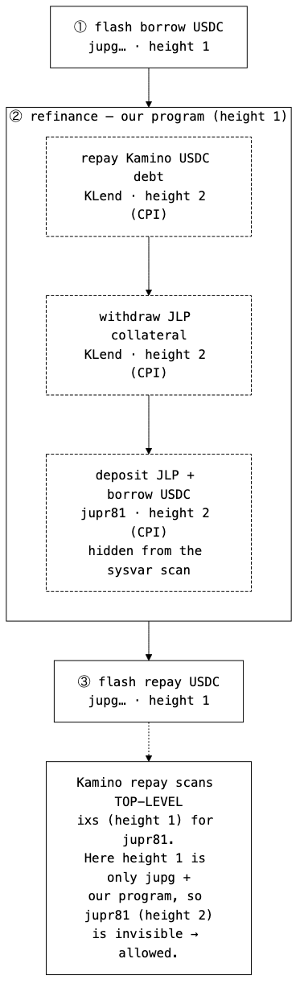
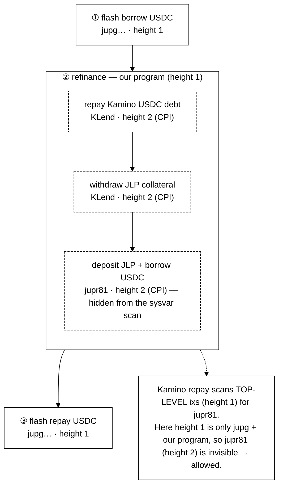

# bypassing-kamino-restrictions

A Pinocchio Solana program that refinances loans between **Kamino Lend** and
**Jupiter Lend** in a single instruction, plus a full test/tooling suite.

> For the *why* — how it bypasses Kamino's anti-refinance restriction — see
> [README1.md](README1.md). This file is setup & usage only.

---

## Prerequisites

| Tool | Version | Notes |
|------|---------|-------|
| Rust + `cargo build-sbf` | Solana platform tools | via the Solana CLI installer |
| Solana CLI | ≥ 1.18 / 2.x | for `cargo build-sbf` |
| Node.js | ≥ 18 (tested on 23) | uses global `fetch` |
| npm | 9+ | (yarn v1 chokes on the litesvm native binary — use npm) |
| Surfpool | ≥ 1.4 | deploys the program + generates keys automatically; needs the `surfnet_*` cheatcodes |
| shank (optional) | 0.4.x | only to regenerate the IDL |

---

## One-time setup

```bash
# JS deps (web3.js, @jup-ag/lend, @kamino-finance/klend-sdk, litesvm, mocha, tsx, …)
npm install

# build the on-chain program -> target/deploy/kamino_juplend_refinance.so
npm run build:program
```

Install surfpool (≥ 1.4) — see [surfpool.run](https://surfpool.run). It handles
program deployment and key generation for you (see below).

---

## Build & IDL

```bash
npm run build:program     # cargo build-sbf + copy .so to target/deploy/
npm run generate:idl      # shank -> idl/kamino_juplend_refinance.json
```

Surfpool deploys the `.so` automatically from the txtx runbook
(`runbooks/deployment`) at the cargo-generated keypair, and the tests resolve
that address on their own — no manual keygen, deploy, or `PROGRAM_ID` wiring.

---

## Run the surfpool integration tests (both refinance directions)

Surfpool auto-deploys the program from the txtx runbook (`runbooks/deployment`)
on startup — no manual keygen or deploy. The tests resolve the deployed program
id and default to the local RPC automatically, so **no env vars are needed**.

```bash
# 1. start a local mainnet-fork surfnet — this ALSO deploys the program
#    (instant cheatcode deploy, Studio explorer at http://127.0.0.1:18488)
surfpool start &

# 2. run the tests (that's it)
npm run test:kamino-to-jup
npm run test:jup-to-kamino
```

Notes:
- Prefer a dedicated RPC to avoid the free public endpoint rate-limiting the lazy
  fork: `surfpool start --rpc-url https://your-rpc-provider.com`.
- `surfpool start --watch` re-deploys automatically when the `.so` changes.
- Surfpool lazily forks live mainnet, so state drifts across many runs. Each test
  uses a fresh payer/obligation/position, so a **clean session is deterministic** —
  just restart surfpool if a run fails after many prior runs.
- Deployment is at the cargo-generated keypair
  `target/deploy/kamino_juplend_refinance-keypair.json`; set `PROGRAM_ID=<addr>`
  only if you deploy somewhere else.

---

## The refinance flow (flashloan, one atomic transaction)

The whole migration happens in a single transaction: a Jupiter Lend **flashloan**
(program `jupg…`, *not* the restricted `jupr81`) supplies the USDC to repay
Kamino, and the USDC borrowed from Jupiter pays the flashloan back.

```bash
surfpool start &          # forks mainnet + auto-deploys the program
npm run flow:tx           # runs it, dumps ./refinance-flow.json, prints the Solscan link
npm run flow:mermaid      # regenerates the diagram below from refinance-flow.json
```

`npm run flow:tx` prints (and stores in `refinance-flow.json`) a **Solscan** link
that points the real solscan.io UI at your local surfnet RPC — open it to
inspect/screenshot the transaction:

```text
https://solscan.io/tx/<SIGNATURE>?cluster=custom&customUrl=http://127.0.0.1:8899/
```

> The script auto-retries the transient "surfnet clock vs. freshly-forked accounts
> out of sync" case. If it still fails after a long-running session (clock drifted
> ahead → interest math overflows), restart surfpool (`pkill -f 'surfpool start';
> surfpool start &` — it re-deploys automatically) and retry; the script prints
> this hint too.

The three top-level instructions are `flash borrow → refinance → flash repay`.
Inside `refinance`, the Kamino repay/withdraw and the Jupiter deposit/borrow all
run at **CPI stack height 2**, so `jupr81` never appears at the top level where
Kamino's `RepayObligationLiquidityV2` scan looks — that's the bypass.

<p align="center">
  
</p>

<details><summary>Mermaid source (generated by <code>npm run flow:mermaid</code>)</summary>



</details>

---

## Run the deterministic LiteSVM test (no network drift)

```bash
npm run dump-fixtures      # dump mainnet fixtures -> tests/fixtures/
npm run test:litesvm
```

---

## Standalone tools

```bash
npm run fetch-markets                     # token pairs refinanceable on both venues + utilization
npm run print-tx <signature> [rpcUrl]     # Solscan-style dump of any transaction
npm run flashloan-demo                     # bypass (allowed) vs control (blocked) — needs surfpool
```

---

## Project layout

```
program/           Pinocchio program (Kamino <-> Jupiter Lend refinance)
  src/entrypoint.rs        instruction dispatch (discriminants)
  src/refinance.rs         the refinance flow + account splitting
  src/protocols/kamino/    Kamino CPIs (init/deposit/borrow/repay/withdraw)
  src/protocols/juplend/   Jupiter Lend CPIs (init/operate)
  src/instructions/        Shank IDL definitions
idl/               generated IDL
tests/             TS helpers + mocha suites + tools   (see tests/README.md)
tests/fixtures/    dumped mainnet state for LiteSVM
scripts/           probes + CLIs (print-tx, dump-fixtures, refinance/​block probes)
runbooks/          txtx deployment runbook (surfpool auto-deploys from here)
```

Full breakdown of every test/script file: [tests/README.md](tests/README.md).

---

## Troubleshooting

- **`surfnet_setAccount` → "Method not found"** — your surfpool is < 1.4; upgrade it.
- **`Failed to fetch accounts from remote` / tx timeouts** — the forked RPC is rate-limited. Start surfpool with `--rpc-url <dedicated RPC>`.
- **`npm install` fails on `litesvm-darwin-*`** — a yarn v1 bug; use `npm install`, not `yarn`.
- **A refinance test fails after several green runs** — session drift; restart surfpool (it re-deploys automatically).
```
